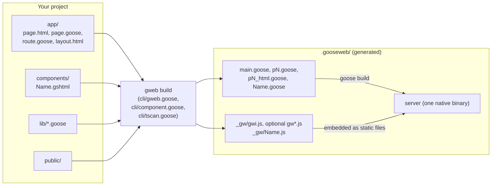
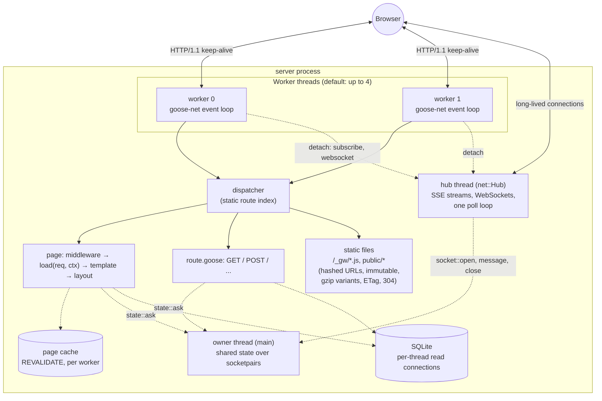
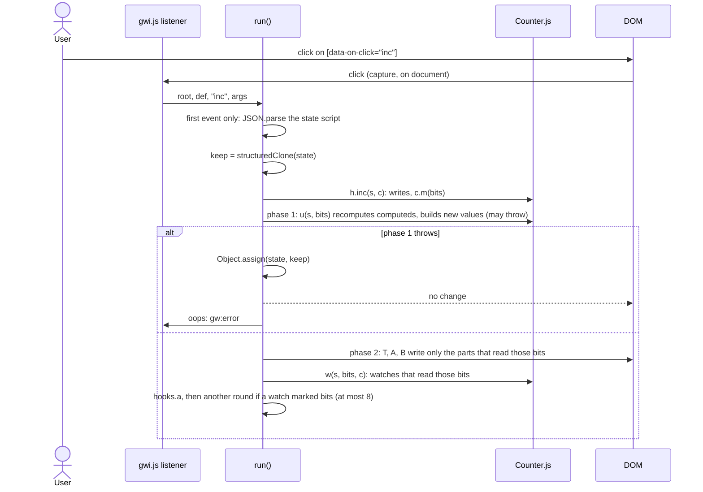
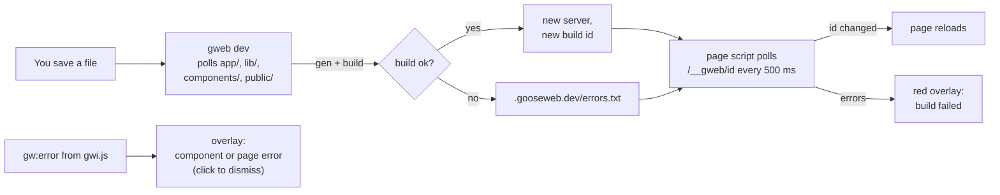

# gweb architecture

How a gweb app is built, how the server answers a request, and what the
browser runtime `gwi.min.js` does. The design records are `DESIGN.md` and
`DESIGN-ADDENDUM-1.md` to `-12-REACTIVITY.md` and `-19-CMS-PHASE1.md`; this file explains the result.

## 1. The big picture

gweb renders every page on the server, in compiled Goose. The browser gets
finished HTML. JavaScript is optional and small, and it does two jobs:

- **Components** (`components/Name.gshtml`): UI state that lives in the
  browser, such as a counter or a quantity picker. The component's Goose code is
  translated to JavaScript, so a click updates the page with no server request.
  A reactive component (`@state`, `@computed`, ...) updates only the parts of
  the page that read what changed.
- **Fragments** (`{#fragment NAME}` in a page): a link or form fetches its
  normal URL, and the server sends back only one named region of the page.

Both jobs use one shared runtime, `gwi.js`. The minified copy, `gwi.min.js`, is
4,079 bytes (ceiling 4,096). Everything else is an optional module (`gwf`, `gwh`,
`gwl`, `gwm`, `gwc`, `gwn`, `gws`, `gwt`, `gwe`, 466 to 1,498 bytes each), served
only to sites that use the feature. Section 4 lists them.



## 2. Build time: what `gweb build` does

1. **Scan** `app/` into a route table. A folder is a URL segment, and `[id]` is
   a parameter. A `page.html` is a page, and a `route.goose` is an API handler.
2. **Copy** your `.goose` files into `.gooseweb/` with a namespace added on
   line 1, so error line numbers still match your files.
3. **Compile each template** (`page.html`, `layout.html`) into Goose. One HTML
   line becomes one Goose line, so a type error in `{p.name}` points at the
   right line of your HTML.
   - `{expr}` becomes `gweb::put(out, expr);`, which writes the value escaped.
   - `{#if}`, `{#for}` and `{#let}` become Goose `if`, `for` and `let`.
   - `@Name(expr)` renders a component, and `@ns::f(a)` calls a partial.
   - `{#fragment NAME}` marks a region that can be served alone.
4. **Translate each component** twice. The `<script goose>` block becomes a
   Goose module, so the server can render the first HTML. The same code becomes
   `_gw/Name.js`, so the browser can run the handlers. `gweb test` runs each
   `test_*` function both ways, and the two outputs must match. For a reactive
   component the compiler also works out which names each function, computed and
   markup part reads and writes, and emits the parts, markers and marks of
   section 4. A store (`stores/Name.gshtml`) compiles the same way, without
   props or markup. Components compile in call order, children first.
5. **Generate views** (`views/<group>/<Name>.goose` and `.html`): the user's code gets a generated codec, form and
   parser after its last line, the template compiles to `render<Z, D>`, and `.gooseweb/views.goose` is the registry.
   See the README, section Views.
6. **Check links**: every `gw-target` must point at a page that has that
   fragment, and a literal `http::get` or `http::post` URL in a component must
   match a route with that method. Otherwise the build fails. Warnings (unknown
   attribute, unkeyed `{#for}`, ...) print and the build goes on; `--strict`
   makes them fail it.
7. **Generate the dispatcher**: a static route index, then `goose build` makes
   one native binary. Static files and the runtime modules in use are compiled
   into it, with hashed URLs (public files) and gzip variants. CSS is minified first (`--no-minify` skips it).
   `@asset`, `@image` and `@meta` are resolved here: hashed URLs and image sizes
   are read from `public/`.

`gweb export` runs the same build, then starts the binary with `--export DIR`: it
renders each static page in process and writes HTML files and assets, with no port.

Templates are type-checked by the Goose compiler. A wrong field name is a build
error, not a blank space on the page.

## 3. Run time: the server



- **Workers.** Each worker thread runs its own goose-net event loop on one shared
  listening socket. A request is parsed, dispatched and answered on the same
  thread. No thread switch happens on the hot path.
- **Dispatcher.** The route table is generated code: a static index, with no
  regex and no lookup map at run time.
- **Pages.** For a page, the worker runs any `middleware.goose`, then
  `load(req, ctx) -> Props` (or `fn POST` for a form post), then the compiled
  template, and the layout wraps the result. `finish()` applies the
  outcome (status, redirect), and `run_worker` adds any queued cookies.
- **Uploads.** A `multipart/form-data` body over 64 KiB is spooled to a file by the goose-net loop
  (`--max-upload`, `--upload-dir`). `gweb::multipart_begin` turns the body into an urlencoded body of the
  text fields plus up to 8 temp files in `ctx.uploads`, so `gweb::form` and the CSRF check work unchanged.
  `run_worker` deletes the spool and unsaved files after the reply.
- **Errors.** `gweb::fail` sets `Outcome.Error`; `finish` answers with the nearest `error.html` (JSON for a
  route). A crash kills the worker thread. `src/inflight.c` keeps each slot's connection and request head, so
  the supervisor renders the error page in a contained thread and sends it with `Connection: close`
  (then the layout-less page, then a fixed plain-text 500). It then frees the dead loop, which closes that
  worker's other connections, and respawns the worker. `gweb::done` lets a handler end the reply itself.
- **Shared state.** Data that all workers must see, such as the in-memory todo
  list, lives on the owner thread. Workers reach it through `owner_call` over a
  socketpair, so it needs no locks.
- **SQLite.** Each thread has its own read-only connection and cached
  statements.
- **Cookies.** `gweb::cookie_or(req, name, fallback)` reads a cookie.
  `ctx` setters queue `Set-Cookie` headers, and `run_worker` applies them.
- **Sessions and security.** `config_from_args` loads `.env` files and `GWEB_SECRET` into `Config`, and
  `run_worker` copies the keys into `Ctx`. A session is a signed cookie that handlers load on demand.
  A GCRA rate table in C is shared by all workers behind one mutex. `run_worker` adds three security
  headers to every response, and a CSP nonce when CSP is on.
- **Static files.** Each file is embedded once and served at a plain URL
  (`max-age=0, must-revalidate`) and a hashed one (`/css/site.3f9a1c2b.css`,
  `max-age=31536000, immutable`). Text files of 1 KB or more also have a gzip
  variant made at build time, sent when the request accepts gzip. `@asset()`
  writes the hashed URL; `/_gw/` files are hashed too.
- **Page cache.** A page with `const REVALIDATE = N;` keeps its 200 GET reply
  for N seconds in a per-worker thread-local cache (`src/cache.c`), with an ETag.
  No lock and no owner round trip; the cost is up to one render per worker.
- **Streaming.** `gweb::stream_begin`, `write` and `end` send a chunked body from
  the handler. The stream holds its worker until it ends.
- **The hub thread.** `gweb::subscribe` (SSE) and `gweb::websocket` (after the
  handshake) set `ctx.detach`. After the handler returns, `run_worker` sends the
  head, takes the socket out of the worker's loop (`Loop.detach`) and gives it to
  one `net::Hub`, which runs every long-lived connection in one poll loop on its own
  thread. Workers and the owner call `gweb::publish` or `gweb::socket_send` from any thread.
  Connection events (`Open`, `Text`, `Binary`, `Close`) reach `app/socket.goose`
  on the hub thread, which can use `state::ask`. The hub exists only when the app
  uses it.
- **Behind a proxy.** TLS, HTTP/2 and compression belong to Caddy or nginx; see
  `DEPLOY-PROXY.md`.

## 4. The browser runtime

The core is `gwi.js` (`gwi.min.js`, 4,079 bytes, ceiling 4,096). Optional modules hold everything else. gweb serves a module only to a site that uses its feature, and the page or component module imports it.

| Module | Holds | Loaded when |
|---|---|---|
| `gwi.js` | helpers, `morph`, `run` (dispatch), parts (`T`, `A`, `B`), listeners, `hooks` | any component |
| `gwf.js` | fragments (`gw-target`) | a page tag, for pages with `gw-target` |
| `gwh.js` | `http::get`, `http::post`, reply decoding | a component module that fetches |
| `gwl.js` | eager start, `@mount`, `@unmount`, `@every`, `@watch` at start | a component with any of these, or `@use` |
| `gwm.js` | `on:EVENT.MOD` modifiers (`prevent`, `stop`, debounce, key filters) | a component module with a modifier |
| `gwc.js` | child props and child-to-parent events | a component module that calls a child |
| `gwn.js` | client navigation | a page tag, when a layout has `<body gw-boost>` |
| `gws.js` | shared stores | a store module, or `gwe.js` |
| `gwt.js` | `gw-enter` and `gw-leave` | a page tag, when markup uses them |
| `gwe.js` | server push (`gw-sse`) | a page tag, when markup uses it |

Core pieces:

| Part | What it does |
|---|---|
| Helpers (`esc`, `at`, `set`, `rm`, `blen`, `cap`, `idiv`, `imod`) | Give the generated component JS the same behaviour as Goose: HTML escaping, bounds checks that throw, byte lengths, string capacities, truncating `/` and Euclidean `%`. |
| `component(name, def)` | Each `_gw/Name.js` calls this to register its def and one capture listener per event type it uses. |
| `run(root, def, name, args, e, bound, m0)` | One dispatch: bind, handler, update, watches, rollback. |
| `T`, `A`, `B` | Write one text, attribute or block part. |
| `morph(from, to, force, s, z)` | Makes the live DOM match new HTML, changing only what differs; optionally only between two markers. |
| `hooks` | Slots the modules fill: `a` after DOM writes, `c` child roots, `e` child events, `m` modifiers, `t` transitions. |

A component is **reactive** (`@prop`, `@state`, `@computed`, ...) or **legacy** (`struct State`). Both register a def with `u` (update) and `h` (handlers), so one `run` serves both. The server markup is the only difference.

### 4.1 What the server sends for a component

Reactive, with markers:

```html
<div data-component="Counter"><button data-on-click="inc">Clicked <!--g-->0<!----> times</button></div><script type="application/json">{"count":0}</script>
<script type="module" src="/_gw/Counter.js"></script>
```

Legacy, no markers (the same tags and JSON):

```html
<div data-component="Counter"><button data-on-click="inc">Clicked 0 times</button>
</div><script type="application/json">{"count":0}</script>
<script type="module" src="/_gw/Counter.js"></script>
```

The page is complete HTML before any JavaScript runs. The JSON (props, state and computeds) is read on the component's first event. This is "resumption": the page costs no JavaScript work until a user touches a component. A component with `@watch`, `@mount`, `@unmount`, `@every` or `@use` starts at load instead (`gwl.js`).

The compiler finds **parts**, the dynamic places outside every `{#if}` and `{#for}`, and the server marks each with a comment:

| Part | Marker | Updated by |
|---|---|---|
| text `{e}` | `<!--g-->` before, `<!---->` after (left out before a tag) | `T`: the text node after the marker |
| attribute list of an open tag | `<!--g-->` before the tag | `A`: the element's whole attribute list |
| block `{#if}`, `{#for}`, `{#raw}` | `<!--g-->` before, `<!--/g-->` after | `B`: keyed morph between the markers |

`anchors(root)` collects the root's own `<!--g-->` comments once, in document order; `p[i]` in the update function is part `i`.

### 4.2 A click in a component

Each name (`@prop`, `@state`, `@computed`) has one bit. The compiler knows which bits each function reads and writes, and puts a **mark** `c.m(BITS)` after every write. `def.u(s, m)` takes the marked bits.



- **One listener per event type** serves every component. Elements carry `data-on-click="inc"` and `data-args="[1]"`, with modifiers as `data-on-keydown="add.enter.prevent"`.
- **`bind:value` and `bind:checked`** copy the input into the state before the handler runs, and mark that name. A number field gets a truncated integer; a string over its capacity is refused and the old value forced back.
- **Phase 1 computes, phase 2 writes.** Phase 1 returns a closure that only touches the DOM, so a failure in phase 1 never leaves a half-applied page.
- **Untouched parts keep their nodes.** A part updates only when its bits are marked. A focused input keeps what the user types.
- **Watches** (`@watch`) run after the DOM writes, only when state they read changed. A watch may write; the loop stops after 8 rounds with `watch loop in Name`. A throwing watch raises `gw:error` and rolls nothing back.
- **Sync rollback.** If the handler or phase 1 throws, the whole state returns to `keep` and the DOM is untouched.
- **Async rollback.** An async handler (`await http::get`, `http::post`, or a call of an async function) may write, then fail. The runtime restores only the names that handler writes (`def.x[name]`, known at build time), flushes them and raises `gw:error`. Writes by other handlers meanwhile survive. A refused optimistic `push` disappears.
- **Legacy components** re-render the whole component to a string and `swap` it through `morph`. Their rollback is the sync one.
- **Child components.** `morph` meets an old and a new root of the same component and hands them to `hooks.c` (`gwc.js`): changed props go into the live child's state, and the child updates from those bits and keeps its own state. A child's `@event` reaches the parent through `hooks.e`, which runs the parent's handler.
- **Stores.** A component with `@use Cart;` keeps copies of the store's scalar values in its own state and subscribes at start (`gws.js`). A store write marks those names in every subscriber and flushes each.

### 4.3 A fragment request

```mermaid
sequenceDiagram
    actor U as User
    participant R as gwi.js
    participant S as Server (worker)
    participant DOM

    U->>R: submit <form gw-target="todo-list">
    R->>R: element #todo-list exists? no modifier key? not inside a component?
    R->>R: preventDefault, mark #todo-list aria-busy
    R->>S: POST /fragments + header GW-Fragment: todo-list
    S->>S: fn POST, then load and render the page
    S-->>R: only the {#fragment todo-list} region<br/>+ GW-Fragment: todo-list, no-store
    alt reply echoes GW-Fragment
        R->>DOM: morph(#todo-list, html), only if this is still the latest request
    else no echo (for example a redirect to another page)
        R->>U: normal navigation to r.url
    else network error or other 4xx/5xx
        R->>R: dispatch gw:error, DOM unchanged
    end
```



- **No separate endpoints.** The fragment is a region of the page that
  `page.html` already declares. The page URL serves both the whole page and the
  region.
- **Without JavaScript** the same form posts normally and gets the whole page.
- **The last request wins.** Each target counts its requests, so a slow, older
  reply is dropped.
- **422.** A 422 reply that echoes `GW-Fragment` is morphed like a 200: that is a form with its errors.
- **Multipart.** A form with `enctype="multipart/form-data"` is sent as `FormData`, not `URLSearchParams`.
- **Loading.** A link, or a form with `gw-loading`, starts a 150 ms timer. If no reply has come, the box's
  children are saved and replaced with the page's `<template id="gw-loading">` (from `loading.html`).
  The reply morphs over it; on failure the saved children return.

### 4.4 `morph`, the shared core

`morph` makes the children of one parent match the new children:

- An element with `gw-key` is keyed. Its key is its tag name plus the `gw-key`
  value; `id` is not a key, and an empty `gw-key` means no key.
- Old keyed children that the new list does not want, or that repeat a key, are
  removed first. The others are put in a map by key.
- Each new keyed child takes the old child with its key, wherever it is. If that
  child is not at the cursor it is moved before the cursor, except when the
  cursor is a keyed child right before it: then the cursor steps over it, which
  makes a swap or a move to the end one move. A moved node that held focus is
  refocused, because `insertBefore` blurs it.
- Each new unkeyed child takes the next unkeyed old child at or after the
  cursor, skipping keyed ones. A keyed child never takes an unkeyed child's slot.
- A new child with no match is inserted before the cursor, and old children left
  after the cursor are removed.
- A match of another node name is replaced, a text node gets its new text, and
  an element gets its attributes synced and `morph` recurses into it.
- A form control gets its `value` and `checked` synced last. The focused
  control keeps what the user is typing, unless the state behind it changed.
- A duplicate key among the new children reports one `gw:error`; the first gets
  the old element and the later ones are built new.

The rule for authors: give `gw-key`, unique among its siblings, to every item
of a list that can be reordered or lose an item other than the last, and to an
element that comes and goes in front of other siblings. An unkeyed element that
comes and goes must be the last child of its parent. The fragments demo puts
its error message in a trailing `<span>` inside the input's own `<p>` for this
reason.

## 5. `gweb dev`



In production (`gweb build` or `gweb start`) there is no dev id, no polling
script and no `/__gweb/id` route. The server ships `gwi.min.js` in place of the
readable `gwi.js`.

## 6. Where each piece lives

| File | Role |
|---|---|
| `gweb.goose` | Server framework: config, workers, `Ctx`, redirects, cookies, dev status and overlay script, fragment replies. |
| `ops/owner.goose`, `src/owner.c` | Owner-thread state over socketpairs. |
| `auth/crypto.goose`, `src/crypto.c` | SHA-256, HMAC, PBKDF2 in C; base64url, constant-time compare, random bytes. |
| `auth/session.goose` | Signed cookies, sessions, `login`/`logout`/`require_login`, password hashes. |
| `auth/rate.goose`, `src/rate.c` | `rate_limit`, `rate_limit_key`, `client_ip`; the shared GCRA table. |
| `auth/cors.goose` | `gweb::cors` for route middleware. |
| `forms/form.goose` | Decodes form bodies for `fn POST`. |
| `forms/valid.goose` | Field errors, checks, template partials and the `form_*` helpers the generated `decode` calls. |
| `forms/upload.goose`, `src/upload.c` | Multipart parser, `gweb::Upload`, `save_upload`, `check_upload`; file helpers in C. |
| `site/errors.goose`, `src/inflight.c` | `ErrorInfo`, `gweb::fail`, crash replies, dev error detail; the in-flight request table. |
| `http/static.goose` | Static files: hashed URLs, immutable caching, gzip variants, ETag and 304. |
| `site/views.goose` | Views runtime: `ViewMeta`, `FieldUi`, `Renamed`, the lenient JSON readers (`jr_*`) and the form controls the generated code calls. In `site/` because a view is page content, like `meta` and `template`. |
| `site/markdown.goose` | `gweb::markdown` and `markdown_text`: the safe Markdown subset. In `site/` for the same reason. |
| `cli/structs.goose` | The struct and enum field scanner shared by the form decoders and the views generator. |
| `cli/views.goose` | The views generator: scans `views/`, writes each view's codec and form, and the `views` registry. |
| `site/meta.goose` | `ctx.meta` setters, `@meta()` rendering and `gweb::site_url`. |
| `site/sitemap.goose` | `/sitemap.xml` and `/robots.txt` builders (`gweb::Sitemap`, `sitemap_add`). |
| `http/cache.goose`, `src/cache.c`, `src/cache_core.[ch]` | The `REVALIDATE` page cache: per-worker store and ETag replies; your own keys and the process-wide epoch (`epoch_bump`). |
| `http/files.goose`, `src/files.c` | `send_file`: a file under a root with ETag and 304, HEAD, Content-Disposition and a window stream for big files; the path check (`..`, dotfiles, symlinks out of the root) in C. |
| `http/stream.goose` | Chunked response bodies: `stream_begin`, `write`, `end`. |
| `http/push.goose` | `subscribe`, `websocket`, `publish`, `send` and the Origin check; the hub side of `run_worker`. |
| `cli/gzip.c`, `cli/gzip_core.[ch]` | Build-time gzip for gweb (zlib; the server never links it). |
| `site/template.goose` | Runtime helpers that compiled templates call (`put`, `raw`, `arg`, JSON). |
| `cli/gweb.goose` | The CLI: scan, generate, build, dev loop, routes, tests. |
| `cli/tscan.goose` | The template scanner shared by both compilers: braces, `@` calls, script and style blocks. |
| `cli/component.goose` | The `.gshtml` compiler: Goose subset parser, type checker, JS emitter. |
| `cli/html.goose` | The HTML attribute lists and the open-tag scan behind the `unknown-attribute` warning. |
| `client/gwi.js` | The browser core. `client/build.sh` minifies every `client/gw*.js` to `gw*.min.js` with a hash banner. |
| `client/gwf.js` | Fragments. |
| `client/gwh.js` | Typed fetch. |
| `client/gwl.js` | Lifecycle and eager start. |
| `client/gwm.js` | Event modifiers. |
| `client/gwc.js` | Child props and events. |
| `client/gwn.js` | Client navigation. |
| `client/gws.js` | Shared stores. |
| `client/gwt.js` | Transitions. |
| `client/gwe.js` | Server push (client half). |
| `client/fnv.mjs` | The FNV-1a hash that `build.sh` and `test/runtime.sh` use for the banners. |
| `test/files_test.goose` | `send_file`: types, ETag and 304, HEAD, options and hostile paths. |
| `test/cmsready.sh`, `test/cmsready/` | A CMS package from a git source, mounted at `/admin` with a module inside it, and a host app: catch-all pages from SQLite, views by name, markdown, `/media`, two hosts with a keyed cache and `epoch_bump`, sitemap per host, an admin edit, an upload. The worked example in `docs/site/building-a-cms.md`. |
| `test/views.sh`, `test/views/` | Views: the generated codec, forms and registry (`gweb test` on `test/views/site`), package views, build errors, `reserved_prefixes`, a variable-size state `Msg`. |
| `test/markdown_test.goose` | `gweb::markdown`: the subset, hostile input, limits, speed. |
| `test/auth.sh`, `cache.sh`, `sitemap.sh`, `push.sh` | Auth, page cache, sitemap and server push suites. |
| `test/forms.sh`, `errors.sh` | Site suites: forms, uploads, `error.html`, crash replies. |
| `test/frag.sh` | `gwf.js` fragments (422, FormData, loading) against jsdom. |
| `test/upload_c.sh`, `inflight_c.sh` | The C helpers against a stub `goose.h`. |
| `test/valid_test.goose`, `upload_test.goose` | Unit tests of the validation and multipart code. |
| `test/components.sh`, `templates.sh`, `fragments.sh` | The compiler, template and fragment suites (`test/components/` holds the `.gshtml` fixtures: legacy, `R*` reactive, `Fail*`, `Warn*`, `stores/`). |
| `test/runtime.sh` | Banner hashes and size ceilings of every minified module, then the node suites below. |
| `test/morph.sh` | The jsdom suite for `morph`; it installs jsdom into a cache on its first run. |
| `test/reactive.sh` | Runs `reactive_test.mjs` (hand-written defs), and `reactive_dom_test.mjs` and `store_dom_test.mjs` (compiled components, when `./gweb` is built). |
| `test/nav_test.mjs`, `transition_test.mjs`, `sse_test.mjs`, `sse_test.goose` | Client navigation, transitions, and server push (client half and `gweb::sse_*` formatters). |

## 7. Limits to know

- Components: no enums or `match`, no f64, and integers above 2^53 lose
  precision in the browser. A component cannot contain itself, and legacy
  components cannot be nested in or call other components.
- A reactive component has at most 31 `@prop`, `@state` and `@computed` names
  (one bit each) and at most one array `@state`.
- A component root is a `<div>`, so a child cannot sit inside `<p>`, `<ul>` or
  `<table>` without a wrapper.
- Inside `{#if}` and `{#for}` a block updates as one region (keyed morph);
  only text and attribute parts outside blocks update one node each.
- Client navigation (`gw-boost`) morphs `<body>` and the title only: no
  `<head>` merge, and inline non-module scripts in the new body do not run.
- A store exposes scalars (`i64`, `bool`, `u8[..N]`) to components; each user
  copies them into its own state, and components cannot assign them.
- Server push needs the streaming hub from the delivery branch. This branch has
  the client (`gwe.js`) and the `gweb::sse_*` formatters only.
- A moved keyed element is reinserted, which reloads an iframe inside it.
- Literal braces outside `<script>` and `<style>` need `&#123;` and `&#125;`.
  A literal `@name(` needs `&#64;`.
- Fragments v1: one swap mode (replace the children of `#NAME`), and no
  component inside a fragment.
- Views: no `f64`; a Props has at most 32 fields and 8 slots; a repeater is the last field and holds scalars, enums and foreign types.
- Form fields are `u8[..N]`, `i64`, `bool` or `gweb::Upload`; no `f64`, enums or multi-select. `lib/` structs get no decoder.
- Uploads: at most 8 files, 64 parts, 64 KiB per text field and 16 KiB of headers per part. `--max-upload`
  is checked by the loop; a page's `const MAX_UPLOAD` only after the body arrived.
- A crash closes the crashed worker's other keep-alive connections; requests read from them get no reply.
- `loading.html` shows for fragment requests only, not on first page load.
- Legacy `struct State` components still work and update by whole-component
  re-render. See Addendum 12 section 10 for porting.
