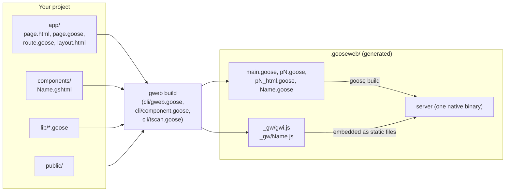
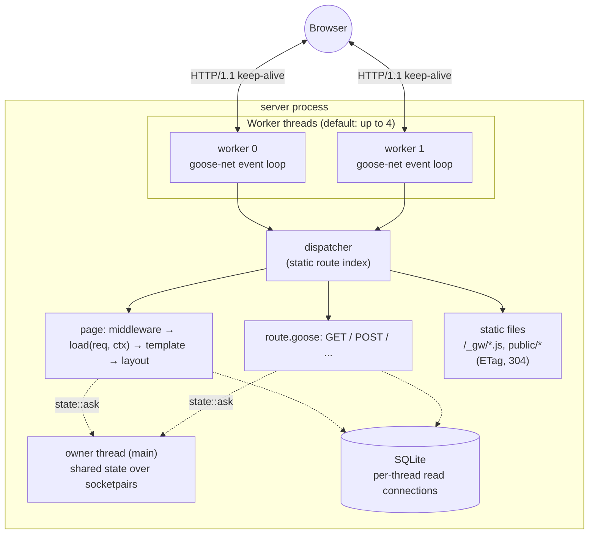
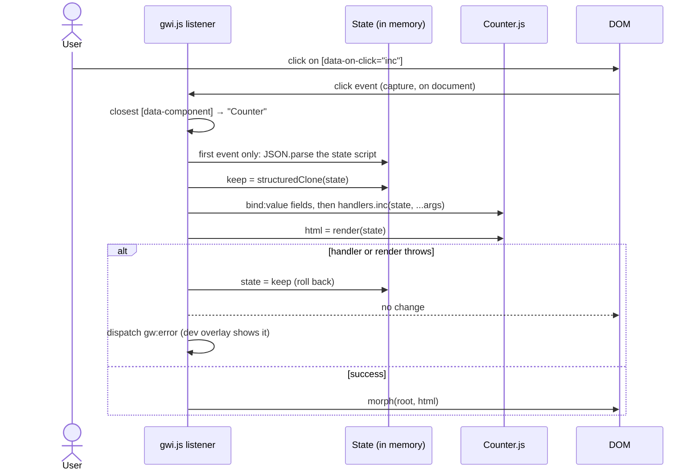
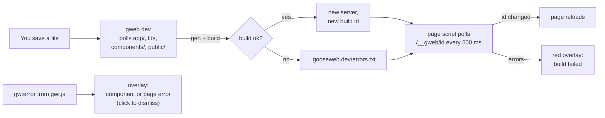

# goose-web architecture

How a goose-web app is built, how the server answers a request, and what the
browser runtime `gwi.min.js` does. The design records are `DESIGN.md` and
`DESIGN-ADDENDUM-1.md` to `-6-SYNTAX.md`; this file explains the result.

## 1. The big picture

goose-web renders every page on the server, in compiled Goose. The browser gets
finished HTML. JavaScript is optional and small, and it does two jobs:

- **Components** (`components/Name.gshtml`): UI state that lives in the
  browser, such as a counter or a quantity picker. The component's Goose code is
  translated to JavaScript, so a click updates the page with no server request.
- **Fragments** (`{#fragment NAME}` in a page): a link or form fetches its
  normal URL, and the server sends back only one named region of the page.

Both jobs use one shared runtime, `gwi.js`. The minified copy, `gwi.min.js`, is
about 3.1 KB.



## 2. Build time: what `gweb build` does

1. **Scan** `app/` into a route table. A folder is a URL segment, and `[id]` is
   a parameter. A `page.html` is a page, and a `route.goose` is an API handler.
2. **Copy** your `.goose` files into `.gooseweb/` with a namespace added on
   line 1, so error line numbers still match your files.
3. **Compile each template** (`page.html`, `layout.html`) into Goose. One HTML
   line becomes one Goose line, so a type error in `{p.name}` points at the
   right line of your HTML.
   - `{expr}` becomes `web::put(out, expr);`, which writes the value escaped.
   - `{#if}`, `{#for}` and `{#let}` become Goose `if`, `for` and `let`.
   - `@Name(expr)` renders a component, and `@ns::f(a)` calls a partial.
   - `{#fragment NAME}` marks a region that can be served alone.
4. **Translate each component** twice. The `<script goose>` block becomes a
   Goose module, so the server can render the first HTML. The same code becomes
   `_gw/Name.js`, so the browser can run the handlers. `gweb test` runs each
   `test_*` function both ways, and the two outputs must match.
5. **Check links**: every `gw-target` must point at a page that has that
   fragment. Otherwise the build fails.
6. **Generate the dispatcher**: a static route index, then `goose build` makes
   one native binary. Static files and the runtime are compiled into it.

Templates are type-checked by the Goose compiler. A wrong field name is a build
error, not a blank space on the page.

## 3. Run time: the server



- **Workers.** Each worker thread runs its own goose-net event loop on one shared
  listening socket. A request is parsed, dispatched and answered on the same
  thread. No thread switch happens on the hot path.
- **Dispatcher.** The route table is generated code: a static index, with no
  regex and no lookup map at run time.
- **Pages.** For a page, the worker runs any `middleware.goose`, then
  `load(req, ctx) -> Props` (or `fn POST` for a form post), then the compiled
  template, and the layout wraps the result. `finish()` applies the
  outcome (status, redirect), and `run_worker` adds any queued cookies.
- **Shared state.** Data that all workers must see, such as the in-memory todo
  list, lives on the owner thread. Workers reach it through `owner_call` over a
  socketpair, so it needs no locks.
- **SQLite.** Each thread has its own read-only connection and cached
  statements.
- **Cookies.** `web::cookie_or(req, name, fallback)` reads a cookie.
  `ctx` setters queue `Set-Cookie` headers, and `run_worker` applies them.

## 4. The browser runtime: what `gwi.min.js` does

`gwi.js` is one ES module. It has four parts.

| Part | What it does |
|---|---|
| Helpers (`esc`, `at`, `set`, `rm`, `blen`, `cap`, `idiv`, `imod`) | Give the generated component JS the same behaviour as Goose: HTML escaping, bounds checks that throw, byte lengths, string capacities, truncating `/` and Euclidean `%`. |
| `component(name, def)` | Each `_gw/Name.js` calls this to register its `render` function and handlers. |
| Component listeners | Four capture listeners on `document`, for `click`, `change`, `input` and `submit`. |
| Fragment listeners | One `click` listener for `a[gw-target]`, and one `submit` listener for `form[gw-target]`. |
| `morph(from, to)` | Makes the live DOM match new HTML, changing only what differs. |

### 4.1 What the server sends for a component

```html
<div data-component="Counter"><button data-on-click="inc">Clicked 0 times</button>
</div><script type="application/json">{"count":0}</script>
<script type="module" src="/_gw/Counter.js"></script>
```

The page is complete HTML before any JavaScript runs. Nothing hydrates at load.
The JSON state is read only on the component's first event. This is
"resumption": the page costs no JavaScript work until a user touches a component.

### 4.2 A click in a component



- **One listener per event type** serves every component on the page. Buttons
  carry `data-on-click="inc"` and `data-args="[1]"`, so the server and the
  browser render the same markup.
- **`bind:value`** copies an input's value into the state before the handler
  runs. A number field gets a truncated integer. A string over its capacity is
  refused.
- **The whole component re-renders** to an HTML string, and `morph` then
  changes only the nodes that differ.
- **Rollback.** If anything throws, the state goes back to its copy and the DOM
  is not touched. The page never shows a half-applied update.

### 4.3 A fragment request

```mermaid
sequenceDiagram
    actor U as User
    participant R as gwi.js
    participant S as Server (worker)
    participant DOM

    U->>R: submit <form gw-target="todo-list">
    R->>R: element #todo-list exists? no modifier key? not inside a component?
    R->>R: preventDefault, mark #todo-list aria-busy
    R->>S: POST /fragments + header GW-Fragment: todo-list
    S->>S: fn POST, then load and render the page
    S-->>R: only the {#fragment todo-list} region<br/>+ GW-Fragment: todo-list, no-store
    alt reply echoes GW-Fragment
        R->>DOM: morph(#todo-list, html), only if this is still the latest request
    else no echo (for example a redirect to another page)
        R->>U: normal navigation to r.url
    else network error or 4xx/5xx
        R->>R: dispatch gw:error, DOM unchanged
    end
```



- **No separate endpoints.** The fragment is a region of the page that
  `page.html` already declares. The page URL serves both the whole page and the
  region.
- **Without JavaScript** the same form posts normally and gets the whole page.
- **The last request wins.** Each target counts its requests, so a slow, older
  reply is dropped.

### 4.4 `morph`, the shared core

`morph` makes the children of one parent match the new children:

- An element with `gw-key` is keyed. Its key is its tag name plus the `gw-key`
  value; `id` is not a key, and an empty `gw-key` means no key.
- Old keyed children that the new list does not want, or that repeat a key, are
  removed first. The others are put in a map by key.
- Each new keyed child takes the old child with its key, wherever it is. If that
  child is not at the cursor it is moved before the cursor, except when the
  cursor is a keyed child right before it: then the cursor steps over it, which
  makes a swap or a move to the end one move. A moved node that held focus is
  refocused, because `insertBefore` blurs it.
- Each new unkeyed child takes the next unkeyed old child at or after the
  cursor, skipping keyed ones. A keyed child never takes an unkeyed child's slot.
- A new child with no match is inserted before the cursor, and old children left
  after the cursor are removed.
- A match of another node name is replaced, a text node gets its new text, and
  an element gets its attributes synced and `morph` recurses into it.
- A form control gets its `value` and `checked` synced last. The focused
  control keeps what the user is typing, unless the state behind it changed.
- A duplicate key among the new children reports one `gw:error`; the first gets
  the old element and the later ones are built new.

The rule for authors: give `gw-key`, unique among its siblings, to every item
of a list that can be reordered or lose an item other than the last, and to an
element that comes and goes in front of other siblings. An unkeyed element that
comes and goes must be the last child of its parent. The fragments demo puts
its error message in a trailing `<span>` inside the input's own `<p>` for this
reason.

## 5. `gweb dev`



In production (`gweb build` or `gweb start`) there is no dev id, no polling
script and no `/__gweb/id` route. The server ships `gwi.min.js` in place of the
readable `gwi.js`.

## 6. Where each piece lives

| File | Role |
|---|---|
| `web.goose` | Server framework: config, workers, `Ctx`, redirects, cookies, dev status and overlay script, fragment replies. |
| `owner.goose`, `src/owner.c` | Owner-thread state over socketpairs. |
| `form.goose` | Decodes form bodies for `fn POST`. |
| `static.goose` | Static files with ETag and 304. |
| `template.goose` | Runtime helpers that compiled templates call (`put`, `raw`, `arg`, JSON). |
| `cli/gweb.goose` | The CLI: scan, generate, build, dev loop, routes, tests. |
| `cli/tscan.goose` | The template scanner shared by both compilers: braces, `@` calls, script and style blocks. |
| `cli/component.goose` | The `.gshtml` compiler: Goose subset parser, type checker, JS emitter. |
| `client/gwi.js` | The browser runtime. `client/build.sh` minifies it to `gwi.min.js`. |
| `test/components.sh`, `templates.sh`, `fragments.sh` | The test suites. |
| `test/morph.sh` | The jsdom suite for `morph`; it installs jsdom into a cache on its first run. |

## 7. Limits to know

- Components: no component inside a component, no enums or `match`, no f64, and
  integers above 2^53 lose precision in the browser.
- A moved keyed element is reinserted, which reloads an iframe inside it.
- Literal braces outside `<script>` and `<style>` need `&#123;` and `&#125;`.
  A literal `@name(` needs `&#64;`.
- Fragments v1: one swap mode (replace the children of `#NAME`), and no
  component inside a fragment.
